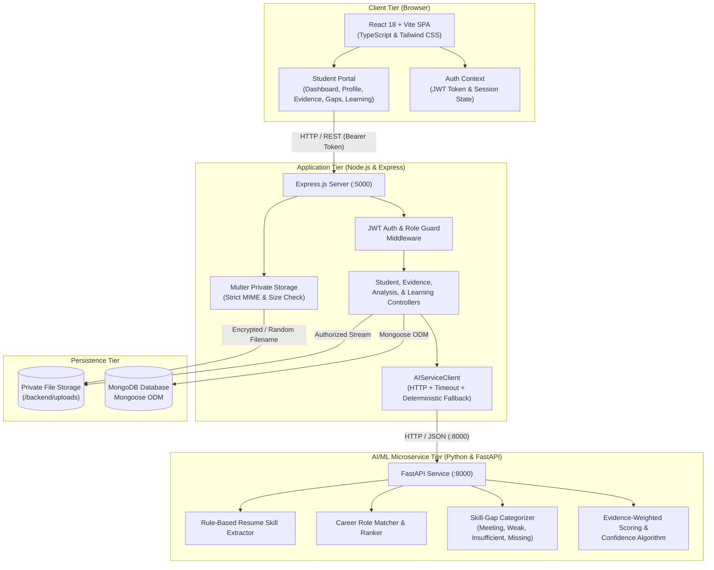

# SkillBridge Architecture Documentation
**AI-Powered Skill Intelligence and Placement Platform — Student Module (Person 2)**

## 1. System Architecture Overview

SkillBridge adopts a three-tier microservice architecture designed for college-wide placement automation and skill evidence verification. The Student Module (Person 2) interfaces with the Express REST API backend and the FastAPI AI/ML microservice.

---

## 2. Component Breakdown

### A. Frontend Application (`frontend/`)
- **Technology Stack**: React 18, TypeScript, Vite, Tailwind CSS, React Router DOM, Axios, React Hook Form.
- **Design Language**: Follows the ProjectSync reference design system:
  - Clean, minimal layout with light neutral canvas (`bg-slate-50`).
  - Core teal/turquoise accent (`primary-600` / `#0d9488`).
  - Rounded white cards (`rounded-xl border border-slate-200/90 shadow-sm`).
  - Persistent sidebar on desktop, collapsible on mobile.
  - Top navigation with breadcrumb, notifications indicator, and student session dropdown.
- **State Management**: React Context (`AuthProvider`) managing token persistence in `localStorage`, user session validation, and profile state.
- **Accessibility & UX**: All screens implement distinct Loading, Empty, Error, and Success states with semantic ARIA roles.

### B. Backend REST API (`backend/`)
- **Technology Stack**: Node.js, Express.js, Mongoose ODM, Helmet, CORS, Express-Rate-Limit, Morgan.
- **Authentication**: Stateless JSON Web Tokens (JWT) signed with HMAC-SHA256, verifying user role ('student') and account status ('active').
- **Private Storage**: Multer disk engine storing resumes and certificates in a backend-managed private directory (`backend/uploads/`) outside public web-server reach. Files are retrieved strictly via an authorized ownership endpoint (`GET /api/evidence/:id/download`).
- **Resilience**: Implements `AIServiceClient` with connection timeouts (6000ms) and local deterministic rule-based calculation fallback if the Python service is offline.

### C. AI/ML Microservice (`ai-service/`)
- **Technology Stack**: Python 3.14, FastAPI, Pydantic v2, Uvicorn, Pytest.
- **Responsibility**: Interpreting student skill evidence, synthesizing multi-source confidence metrics, computing career readiness scores, and categorizing skill gaps.
- **Security**: The AI service receives strictly sanitized payloads containing skill names, evidence types, verification statuses, and dates. It never receives passwords, JWT secrets, or filesystem paths.

---

## 3. Data Flow

### 1. Evidence Submission & Evaluation Flow
1. Student submits a project, certificate, or assessment via `POST /api/evidence` (and optionally uploads a file via `POST /api/evidence/upload`).
2. Express validates payload, stores metadata in MongoDB with `student = req.user._id`, and secures any uploaded file.
3. When the student loads the Dashboard or Gap Analysis, Express collects all student evidence and sends it to FastAPI `POST /analyze-skills`.
4. FastAPI evaluates evidence type weights, verification multipliers, source diversity, and recency, returning proficiency scores (0-100) and confidence levels (`High`, `Medium`, `Low`).
5. Express persists the evaluation snapshot in MongoDB `SkillAnalysis` and returns the consolidated intelligence to the React frontend.

### 2. Career Role Alignment & Gap Identification Flow
1. Student chooses a target role (e.g. "Full-Stack Developer") from the catalog.
2. The system compares role required competencies against evaluated skills.
3. The engine categorizes each skill into:
   - **Meeting**: Proficiency satisfies or exceeds threshold with sufficient confidence.
   - **Weak**: Proficiency falls below the target threshold.
   - **Low Evidence Confidence**: Preliminary claims or unverified evidence exist, but lack independent confirmation.
   - **Unevidenced (Missing)**: No evidence records exist for this skill.
4. FastAPI matches identified gaps to curated learning resources and explains the priority for each recommendation.
