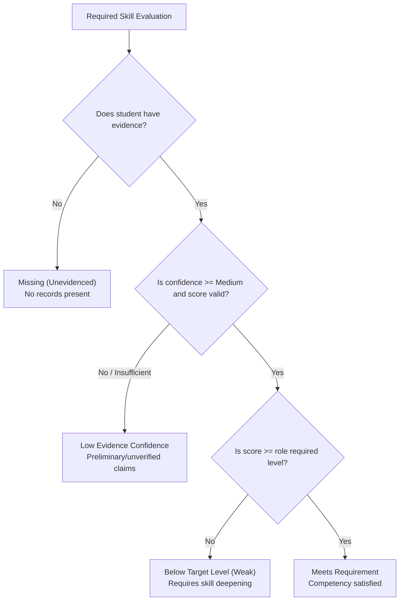

# Skill Scoring & Evidence Intelligence Methodology
**SkillBridge Deterministic AI/ML Engine**

## 1. Core Principles

SkillBridge implements a transparent, explainable scoring engine. Rather than using an opaque black-box or generating fabricated numbers, the platform calculates evidence-backed ratings derived from verifiable student activities.

Key Design Tenets:
1. **Separation of Proficiency and Confidence**: A student may claim high proficiency on a resume, but confidence remains low without independent proof.
2. **Evidence Weighting**: Practical projects and proctored assessments carry significantly higher weight than self-reported resume claims.
3. **No Fabrication on Missing Evidence**: If no evidence exists for a skill, the system returns `insufficient_evidence` (`score: null`) rather than inventing a number.
4. **Placement Disclaimers**: Skill readiness scores represent educational alignment against standard industry benchmarks; they never claim to be guaranteed hiring probabilities.

---

## 2. Proficiency Scoring Formulation

When evidence records exist for a skill, the proficiency score $S \in [20, 98]$ is calculated as:

$$S = \frac{\sum_{i=1}^{n} R_i \cdot W_i \cdot V_i}{\sum_{i=1}^{n} W_i \cdot V_i}$$

Where:
- $R_i$: Raw score or baseline rating for evidence item $i$.
  - Proctored assessment: Exact examination score (0–100).
  - Internship: Base rating of 80.0.
  - Practical project: Base rating of 75.0.
  - Coding platform track: Base rating of 78.0.
  - Technical achievement / Hackathon: Base rating of 72.0.
  - Course certification: Base rating of 65.0.
  - Resume mention: Base rating of 45.0.
- $W_i$: Evidence type weight factor:
  - Assessment: $1.4$
  - Internship: $1.2$
  - Project: $1.1$
  - Coding profile: $1.0$
  - Achievement: $0.9$
  - Certificate: $0.7$
  - Resume: $0.4$
- $V_i$: Verification status multiplier:
  - Verified: $1.0$
  - Pending: $0.75$
  - Unverified: $0.50$
  - Rejected: $0.0$ (excluded from calculation)

---

## 3. Evidence Confidence Formulation

Confidence $C \in [0.0, 1.0]$ measures the sufficiency, diversity, and independent verification of the supporting evidence:

$$C = \min\left(0.35 \cdot \frac{D}{3} + 0.40 \cdot \frac{N_{\text{verified}}}{N_{\text{total}}} + 0.25 \cdot \frac{N_{\text{total}}}{4},\; 1.0\right)$$

Where:
- $D$: Number of unique evidence categories (e.g. project + assessment + certificate = $D=3$).
- $N_{\text{verified}}$: Count of independently verified evidence records.
- $N_{\text{total}}$: Total count of non-rejected evidence records.

### Confidence Bands
- **High Confidence**: $C \ge 0.75$ (Multiple independent, verified sources).
- **Medium Confidence**: $0.45 \le C < 0.75$ (At least one verified source or multiple unverified records).
- **Low Confidence**: $C < 0.45$ (Single unverified claim or preliminary resume mention).

---

## 4. Skill-Gap Categorization

When evaluated against a career role definition, each required competency is classified into one of four states:

1. **Meets Requirement (`meeting`)**: Student proficiency $\ge$ role threshold with at least Medium confidence.
2. **Below Target Level (`weak`)**: Evidence exists and score is computed, but proficiency falls below the role threshold.
3. **Low Evidence Confidence (`insufficient_evidence`)**: Items exist, but all are unverified or total evidence weight is too low to compute a reliable proficiency score.
4. **Unevidenced (`missing`)**: No evidence items exist for this skill.

---

## 5. Role Readiness Score

Role readiness $R \in [0, 100]\%$ measures overall alignment across all competencies in a job role:

$$R = \frac{\sum_{j=1}^{m} A_j \cdot I_j}{\sum_{j=1}^{m} I_j} \times 100$$

Where:
- $I_j$: Importance weight ($1.5$ for `required` competencies, $1.0$ for `preferred` competencies).
- $A_j$: Achievement fraction for competency $j$:
  - Meeting: $1.0$
  - Weak: $\frac{\text{Student Level}}{\text{Required Level}}$
  - Low Confidence: $0.25$ (partial credit for preliminary claims)
  - Missing: $0.0$

### Readiness Bands
- **High Readiness**: $\ge 80\%$
- **Moderate Readiness**: $60\% - 79\%$
- **Developing**: $40\% - 59\%$
- **Early Stage**: $< 40\%$

---

## 6. Ethical AI Safeguards

- **No Demographic Attributes**: Race, gender, religion, age, and caste are strictly excluded from all scoring algorithms.
- **Auditable Explanations**: Every evaluated skill includes human-readable rationale explaining exactly which evidence items contributed to the score.
- **Resume Extraction Transparency**: Resume text parsing identifies candidate keywords, but explicitly flags them as unverified self-reported claims.
